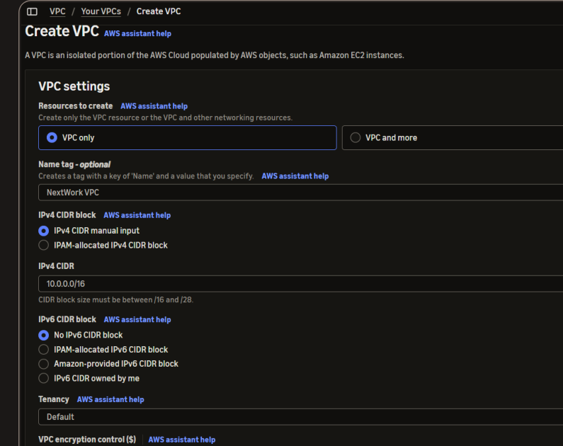
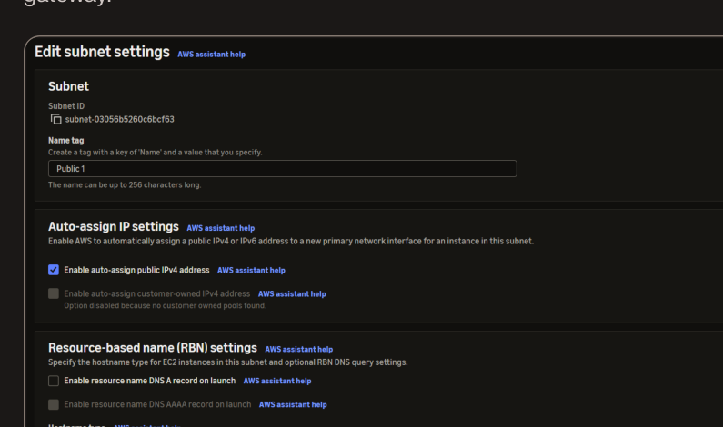
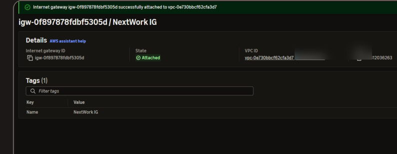
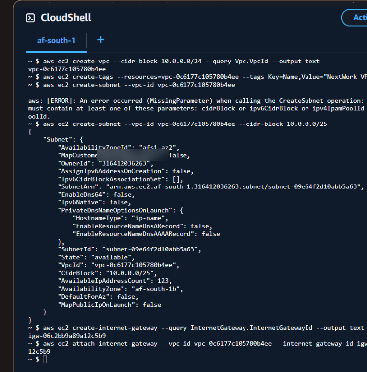

# Build a Virtual Private Cloud (VPC)

**Hands-on AWS networking project**  
**Author:** Ephraim Nenyi Bondzie-Quaye  
**Date:** November 2026  
**AWS Region shown in CloudShell evidence:** `af-south-1`

---


## Project Overview

In this project, I practised creating and configuring an Amazon Virtual Private Cloud (VPC). I explored how a VPC provides an isolated network in AWS, how IPv4 CIDR blocks define its address space, how subnets divide that space, and how an Internet Gateway connects a VPC to the internet.

I used two ways to work with AWS:

- **AWS Management Console** — the graphical interface for creating and configuring resources.
- **AWS CloudShell with the AWS CLI** — a browser-based terminal for creating and managing resources with commands.

The project helped me compare these approaches and build a practical understanding of basic AWS networking.

## Project Goals

- Create a VPC and choose an IPv4 CIDR block.
- Understand how CIDR notation controls the size of an IP address range.
- Create a subnet inside a VPC.
- Understand the difference between public and private subnets.
- Explore the setting for automatically assigning public IPv4 addresses.
- Create and attach an Internet Gateway.
- Repeat VPC tasks using AWS CloudShell and AWS CLI.
- Recognise and troubleshoot common VPC and subnet creation errors.

## AWS Services and Tools

| Service / Tool | How it was used |
|---|---|
| Amazon VPC | Created the logically isolated virtual network. |
| Subnets | Divided a VPC's IP address range into smaller network segments. |
| Internet Gateway | Created and attached a gateway to the VPC. |
| AWS Management Console | Used the graphical interface to configure VPC resources. |
| AWS CloudShell | Used a browser-based shell to run AWS CLI commands. |
| AWS CLI | Issued commands to create and manage VPC resources. |

---

## 1. Virtual Private Clouds (VPCs)

### What I did

I opened the VPC service in the AWS Management Console to begin creating and configuring a virtual network.

### How VPCs work

A Virtual Private Cloud (VPC) is a logically isolated virtual network in AWS. It gives you control over network settings such as IP address ranges, subnets, route tables and network gateways.

A useful way to picture a VPC is as a private area or city. The VPC defines the overall network space, while subnets divide that space into smaller sections where resources can be placed.

### Why AWS accounts have a default VPC

AWS accounts commonly include a default VPC in each Region. It makes it easier to launch certain AWS resources without first building a VPC from scratch. For this project, I also practised creating a VPC myself so I could understand the networking setup.

### VPC configuration in the AWS Console

The console screenshot below shows the VPC creation form. The IPv4 CIDR entered in this console configuration was `10.0.0.0/16`.



---

## 2. Defining IPv4 CIDR Blocks

### What CIDR means

CIDR stands for **Classless Inter-Domain Routing**. CIDR notation is used to describe an IP address range. It combines a network address with a prefix length, such as `10.0.0.0/16`.

The number after the slash tells us how many bits identify the network. In IPv4, there are 32 bits in total. The remaining bits are available for addresses within that network.

A useful beginner rule is:

- A **smaller prefix number** generally means a larger address range.
- A **larger prefix number** means a smaller address range.

For example, `10.0.0.0/16` contains a much larger range than `10.0.0.0/24`.

### Why CIDR planning matters

When creating subnets, each subnet must use an address range that belongs inside the VPC's range. Subnet ranges in the same VPC must not overlap. Planning the CIDR ranges before creating resources helps avoid address conflicts.

---

## 3. Subnets

### What I did

I explored subnet creation because subnets divide a VPC into smaller network segments. This makes it possible to organise resources and apply different routing and security arrangements.

### How subnets work

A subnet is a range of IP addresses within a VPC. In AWS, each subnet belongs to one Availability Zone in a Region.

My AWS account also displayed existing subnets in the default VPC. These were separate from the subnet I practised creating for this project.

### Public and private subnets

The key difference is how traffic is routed:

- A **public subnet** has a route table entry that sends internet-bound IPv4 traffic (commonly `0.0.0.0/0`) to an Internet Gateway attached to the VPC.
- A **private subnet** does not have a direct route to an Internet Gateway. It can still have other forms of connectivity, such as access through a NAT Gateway, depending on the network design.

**Important:** Attaching an Internet Gateway to a VPC by itself does not automatically make every subnet public. The subnet's route table must direct internet-bound traffic to the Internet Gateway. Resources also need appropriate public addressing and security rules to communicate with the internet.

### Auto-assigning public IPv4 addresses

I enabled the **Auto-assign public IPv4 address** setting in the subnet settings shown below. When enabled, instances launched into that subnet can automatically receive a public IPv4 address, subject to the launch configuration and AWS behaviour.

This setting alone does not make a subnet public; the route table and other network settings still matter.



---

## 4. Internet Gateways

### What I did

I created an Internet Gateway and attached it to my VPC. An Internet Gateway is the VPC component that allows communication between a VPC and the internet when the required routing and addressing settings are also in place.

### How an Internet Gateway works

An Internet Gateway acts as a connection point between a VPC and the public internet. For an IPv4 resource to communicate directly with the internet, the network must be configured correctly. This normally includes:

1. An Internet Gateway attached to the VPC.
2. A route in the relevant subnet's route table directing internet-bound traffic (for example, `0.0.0.0/0`) to that gateway.
3. A public IPv4 address on the resource.
4. Security group and network ACL rules that permit the required traffic.

The screenshot below records the Internet Gateway in the **Attached** state. It demonstrates that the gateway was attached to the VPC. It does not, by itself, prove that a complete internet route or end-to-end connectivity test was configured.



---

## 5. Using AWS CloudShell and the AWS CLI

### What I did

As an extension to the console work, I used AWS CloudShell to create and manage VPC resources with AWS CLI commands. I wanted to compare using commands with configuring resources through the graphical console.

### CloudShell and CLI explained

**AWS CloudShell** is a browser-based shell provided by AWS. It lets you run command-line tools, including the AWS CLI, without having to install them on your own computer.

**AWS CLI** means AWS Command Line Interface. It allows you to interact with AWS services by entering commands in a terminal rather than selecting options in a graphical interface.

### Commands used

The commands below show the workflow represented in my CloudShell screenshot. Replace the example VPC ID with the ID returned in your own account.

**1. Create a VPC**

```bash
aws ec2 create-vpc \
  --cidr-block 10.0.0.0/24 \
  --query Vpc.VpcId \
  --output text
```

**2. Add a Name tag to the VPC**

```bash
aws ec2 create-tags \
  --resources YOUR_VPC_ID \
  --tags Key=Name,Value="NextWork VPC 2"
```

**3. Create a subnet inside the VPC**

```bash
aws ec2 create-subnet \
  --vpc-id YOUR_VPC_ID \
  --cidr-block 10.0.0.0/25
```

**4. Create an Internet Gateway**

```bash
aws ec2 create-internet-gateway \
  --query InternetGateway.InternetGatewayId \
  --output text
```

**5. Attach the Internet Gateway to the VPC**

```bash
aws ec2 attach-internet-gateway \
  --vpc-id YOUR_VPC_ID \
  --internet-gateway-id YOUR_INTERNET_GATEWAY_ID
```

The CloudShell screenshot shows the VPC creation command, tagging, successful subnet creation, Internet Gateway creation and attachment. The subnet response reports the state as `available`.



### CIDR range used in the CloudShell exercise

In the CloudShell example, the VPC was created with `10.0.0.0/24`, and the subnet was created with `10.0.0.0/25`.

A `/24` contains 256 IPv4 addresses. A `/25` contains 128 addresses. The `/25` range fits inside the `/24` VPC range.

AWS reserves five IPv4 addresses in every subnet, so a `/25` subnet has 123 addresses available for resources. This matches the `AvailableIpAddressCount` value shown in the command output.

---

## 6. Troubleshooting and Errors I Encountered

While practising with the AWS CLI, I encountered errors when creating subnets. These errors helped me understand why CIDR planning and required command parameters matter.

### `InvalidSubnet.Conflict`

**What happened:** I attempted to create a subnet with a CIDR range that overlapped with a subnet that already existed in the VPC.

**What I learned:** Subnets in the same VPC cannot have overlapping IPv4 CIDR ranges. I need to plan separate address ranges before creating additional subnets.

### `MissingParameter`

**What happened:** I ran the `create-subnet` command without providing a required CIDR parameter.

**What I learned:** I must include the required parameters, such as `--vpc-id` and `--cidr-block`, when creating a subnet.

### `InvalidSubnet.Range`

**What happened:** I tried using `10.0.0.0/32` as a subnet range. AWS rejected it because `/32` is not an allowed IPv4 subnet size for an Amazon VPC subnet.

**What I learned:** AWS IPv4 subnet CIDR blocks must be between `/16` and `/28`. I should check the permitted range and make sure the subnet CIDR fits inside the VPC CIDR.

### How I can avoid these errors

- Check the VPC CIDR range before creating subnets.
- Make sure every subnet range is inside the VPC range.
- Ensure subnet CIDR ranges do not overlap.
- Use a valid AWS subnet prefix length (`/16` through `/28`).
- Include all required command parameters.
- Check the command output to confirm whether a resource was created successfully.

---

## 7. Comparing AWS CloudShell with the AWS Management Console

### Advantages of CloudShell and CLI

- Commands can be repeated, which is useful when carrying out similar tasks.
- The CLI makes it possible to manage resources without navigating through multiple console pages.
- Learning CLI commands builds experience with command-line cloud administration.

### Advantages of the AWS Management Console

- The graphical interface makes it easier to see available settings and configuration options.
- It can be more approachable when learning a service for the first time.
- Resource pages make it easier to inspect the configuration and status of AWS resources.

### My preference

Overall, I preferred using **CloudShell** because it helped me understand how AWS commands work and gave me practical experience managing resources through the command line. However, I also found the AWS Management Console useful for visualising and understanding the resources I created.

I see value in knowing both methods: the console helps me explore and inspect resources, while the CLI helps me practise repeatable command-based operations.

---

## 8. Key Takeaways

Through this project, I gained practical experience and improved my understanding of:

- What an Amazon VPC is and why it is used.
- How IPv4 CIDR blocks define network address ranges.
- How subnets divide a VPC's address space.
- The difference between public and private subnet routing.
- The purpose of an Internet Gateway.
- How to create and manage VPC resources through the AWS Management Console.
- How to use AWS CloudShell and AWS CLI commands.
- How to read AWS error messages and troubleshoot configuration mistakes.

## 9. Conclusion

This project gave me hands-on practice with the fundamentals of AWS networking. Using both the AWS Management Console and CloudShell helped me understand the same cloud environment from both a graphical and command-line perspective.

The troubleshooting process was also valuable because it showed me how important it is to plan CIDR ranges carefully, avoid overlapping subnets and provide all required CLI parameters.

This is an ongoing learning journey, and I plan to build on these networking fundamentals as I continue developing my cloud computing skills.

---

**Author:** Ephraim Nenyi Bondzie-Quaye  
**Project:** Build a Virtual Private Cloud (VPC)  
**Platform:** Amazon Web Services (AWS)
